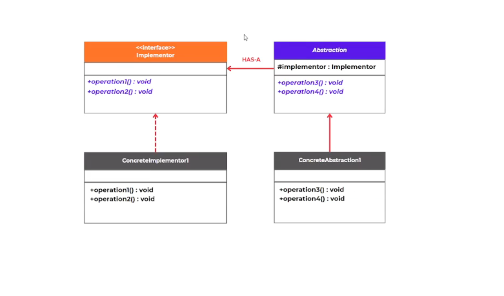
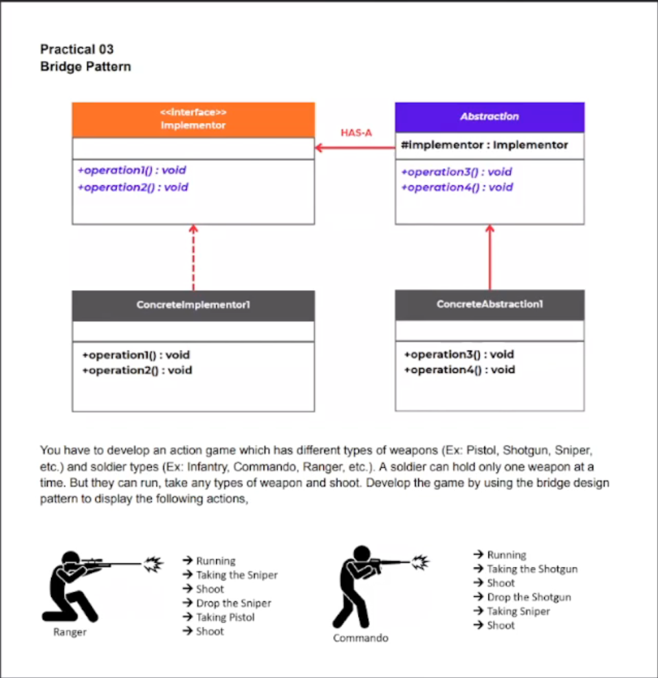
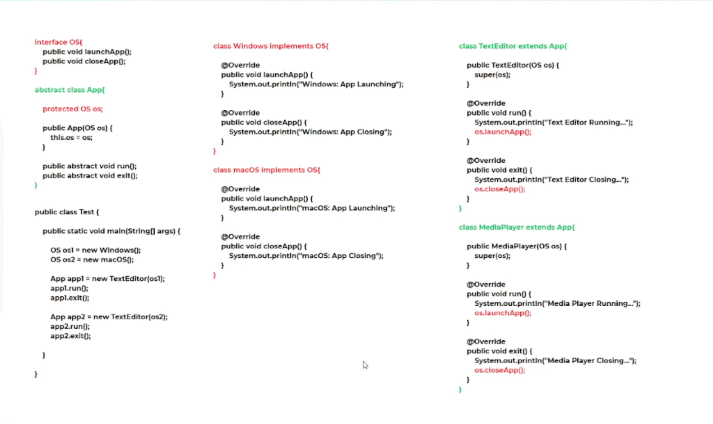

# Bridge Design Pattern

This project demonstrates the Bridge Design Pattern in Java using a real-world-inspired system where two dimensions can vary independently:

- Abstraction: the higher-level concept or entity
- Implementation: the underlying platform or concrete behavior

The pattern helps avoid a permanent binding between an abstraction and its implementation, making the design more flexible and scalable.

## 1. What is the Bridge Design Pattern?

The Bridge Design Pattern is a structural design pattern that separates an abstraction from its implementation so that both can vary independently.

Instead of creating a large class hierarchy for every combination, the pattern uses composition:

- Abstraction contains a reference to an Implementor
- Implementor defines the platform-specific behavior
- Concrete implementations can change without modifying the abstraction hierarchy

This is especially useful when:

- multiple abstractions must work with multiple implementations
- a class hierarchy would become too large
- the system should support extension in both dimensions independently

## 2. Core Idea

The Bridge pattern solves the problem of coupling between:

- abstract concepts (such as `Soldier`, `App`, `Vehicle`, `Shape`)
- concrete implementations (such as `Sniper`, `Pistol`, `WindowsOS`, `MacOS`)

By using an interface/abstract class for the implementation and storing it in the abstraction, the code can be extended without creating a class explosion.

## 3. Usage / When to Use

Use the Bridge Design Pattern when:

- you want to avoid a rigid inheritance structure
- you need to support multiple independent variations
- you expect both abstraction and implementation to evolve separately
- you want to reduce duplication in large class hierarchies
- you need to change implementations at runtime

Examples:

- GUI applications with different operating systems
- Games with different characters and weapons
- Payment systems with multiple gateways
- Database connectivity across different drivers
- Device and remote control combinations

## 4. Suitable Scenarios

Bridge is suitable when:

- abstraction and implementation are orthogonal
- there are multiple combinations of features
- new implementations are likely to be added often
- code must be scalable and maintainable

## 5. Not Suitable / When Not to Use

Avoid using the Bridge Pattern when:

- there is only one fixed implementation and no need for variation
- the abstraction and implementation are not independent
- the hierarchy is simple and will not grow
- the design is small and a direct class design is easier to understand

If the system is small and static, using Bridge may add unnecessary complexity.

## 6. Advantages (Haa Awasthawa / Benefits)

- Reduces class explosion
- Supports independent abstraction and implementation changes
- Improves extensibility
- Encourages composition over inheritance
- Makes code easier to maintain and scale

## 7. Disadvantages / Drawbacks

- Adds complexity compared to simple inheritance
- Requires a careful design of abstraction and implementation interfaces
- Can be harder for beginners to understand

## 8. General Class Diagram

This is the general structure of the Bridge Pattern.

### General Structure

- `Abstraction`: defines the high-level interface and holds a reference to `Implementor`
- `RefinedAbstraction`: extends `Abstraction` with specialized behavior
- `Implementor`: interface for concrete implementation details
- `ConcreteImplementorA/B`: actual platform-specific implementations

## 9. Project Example: Military Game

This repository demonstrates the Bridge Pattern using a game example with soldiers and weapons.

### Example concept

- `Soldier` is the abstraction
- `Weapon` is the implementor
- `Ranger` and `Commando` are refined abstractions
- `Sniper`, `Shotgun`, and `Pistol` are concrete implementors

The code allows a soldier to change weapons dynamically while keeping the soldier behavior independent from the weapon type.

### Practical Example Output

### Code Example

### Source Files

- `src/main/java/lk/kaushalya/practical/Practical.java`
- `src/main/java/lk/kaushalya/model/Test.java`

## 10. Java Implementation Notes

The main practical example in `Practical.java` follows this logic:

- `Weapon` defines common behavior: `shoot()`, `drop()`, `take()`
- `Soldier` contains a `Weapon` reference
- `Ranger` and `Commando` can run and switch weapons without changing their core logic

This demonstrates how the Bridge pattern decouples the abstraction (soldier) from the implementation (weapon).

## 11. Real-World Implementation Examples

### Example 1: Operating System Applications

An app can run on different operating systems without changing its logic.

- `App` is the abstraction
- `OS` is the implementor
- `TextEditor` and `MediaPlayer` are refinements
- `WindowsOS` and `MacOS` are concrete implementations

This is similar to the `Test.java` file in this project.

### Example 2: Remote Control and Devices

- Remote control is the abstraction
- TV / sound system / projector is the implementor
- different devices can be controlled using the same remote interface

### Example 3: Payment Gateways

- Payment service is the abstraction
- different providers such as Visa, PayPal, Stripe are implementations
- the business logic remains independent from the gateway used

## 12. Summary

The Bridge Design Pattern is useful when there are multiple dimensions of change and the system must remain flexible, maintainable, and extensible. In this project, the pattern is demonstrated through soldiers and weapons, plus a second example using applications and operating systems.

### In one sentence:

Bridge separates the abstraction and implementation so both can change independently without creating fragile, tangled inheritance hierarchies.

## 13. Project Status

This project includes:

- theory notes
- usage guidance
- suitable vs not suitable cases
- advantages and disadvantages
- general class diagram
- practical implementation example
- real-world examples
- Java code demonstration

All requested items have been added to the project documentation.
